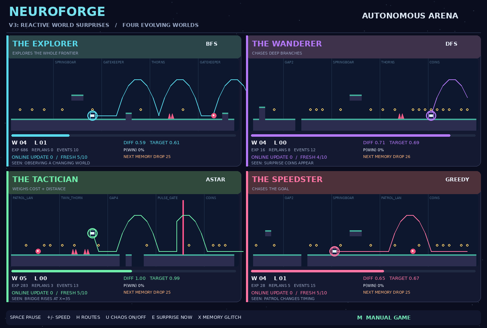

# NEUROFORGE V3 — Four Minds, Dynamic Worlds & Reactive Surprises

**A Mario-inspired original neon platformer with BFS, DFS, A*, Greedy, Backtracking CSP/Forward Checking/AC-3, a trainable neural completion predictor, and incremental on-device learning.**



*This preview was rendered offline using actual generated levels and agent states; it is not a capture from Pygame.*

## Start playing

1. Install Python 3.11+ and open a terminal in this project directory.
2. Install dependencies: `python -m pip install -r requirements.txt`.
3. **Integrated demo + manual gameplay:** `python run_demo.py` prints the input level, the CSP counters and the four search solutions, saves the cooperation plot `results/demo_integration.png`, then opens the game. Add `--no-report` to open the game directly, or `--headless` to skip the game.
4. **Four-agent split-screen AI arena:** `python run_demo.py --arena`
5. Switch manual → arena with **V**, and arena → manual with **M**.

### Manual mode controls

- `A/D` or Left/Right arrows — move; `Space/W/Up` — jump
- `Tab` — AI Laboratory; `1/2/3/4` — BFS/DFS/A*/Greedy visualization
- `F` — Forward Checking, `C` — AC-3, `G` — generate with current CSP options
- `N` — neural vs rule-based coach, `X` — manual partial memory glitch
- `V` — four-agent arena, `R` — restart, `Esc` — quit

### Arena controls

- `U` — enable/disable unexpected world changes during the current attempt
- `E` — force an immediate surprise event and watch each affected agent replan
- `Space` — pause; `+/-` — simulation speed; `H` — toggle planned routes
- `D` — toggle scheduled partial forgetting; `X` — trigger a memory glitch now
- `M` — back to manual mode; `R` — restart arena; `S` — screenshot; `Esc` — quit

**Moving platforms, patrolling enemies and timed gates** are simulated with a time phase shared by the player and planners. The arena also randomly adds spikes, patrols, bridges or coins, and changes the timing of existing moving objects. Each event is checked for survivability; the affected agent observes the change and replans using its own search algorithm. The surprise sequence is reproducible by seed but is not visible to the planner in advance. View [the V3 reactive-world design](docs/V3_REACTIVE_WORLD.md) for limitations.

Each of the four simultaneous panels is a **different autonomous player**. BFS, DFS, A* and Greedy choose their own actions; the neural network **does not control movement**. Each player accumulates gameplay data and uses a separate little calibration adapter to choose a difficulty appropriate to its history. The level generator is the Backtracking/Forward Checking/AC-3 CSP; search verifies playability.

## How incremental learning and occasional forgetting work

The included frozen 12→32→16→1 NumPy MLP was trained **offline once** on 6,500 synthetic gameplay outcomes. During play, *the original model is not retrained*. For each player, a 13-parameter logistic residual layer learns from precisely **10 new attempts at a time**, then clears its mini-batch. It never revisits the original dataset or earlier ten-attempt batches.

- **Feature dropout:** 12% of adapter features are masked during each small SGD step to regularize training; this doesn't erase learned weights.
- **Deliberate forgetting / memory glitch:** by default, every **3 online updates** (30 attempts), 35% of the non-bias adapter features are reset to zero. The base MLP stays intact. Fresh future batches must recover the adapter's calibration; the next two new-only mini-batches use a 1.4× adapter learning rate to aid recovery. Press **X** to trigger one deliberately, or **D** to disable scheduled glitches in the arena.
- **Recovery monitoring:** saves prequential batch log-loss, weights erased, norms before/after, win/loss outcomes and update counts. Forgetting is **not guaranteed** to improve learning. Ablation against no forgetting is included.
- **Persistence:** GUI attempts and online adapter states are saved locally in `data/generated/*gameplay.jsonl` and `models/online/*.json`. The system reloads the latest profile without replaying the old data for gradient steps. Headless runs are nonpersistent by default.

**This is parameter-efficient residual fine-tuning inspired by the spirit of PEFT, but it is not LoRA.** The forgetting is an additional teaching/experimentation device, not ordinary dropout.

## Reproduce the science

```bash
# Dataset and initial offline model (not run every 10 attempts).
# Also downloads + preprocesses four real VGLC level maps (pinned commit,
# SHA-256 checked); add --no-download when offline.
python -m data.make_data --seed 42 --personas 250 --attempts 26
python -m nn.train --seed 42

# Core integrated headless demo, all 4 search algorithms
python run_demo.py --headless --seed 42

# Four independent autonomous agents, including an online reset at 30 attempts
python run_demo.py --arena-headless --rounds 34 --forget-every 3

# Test live world surprises and replanning (simulation-only)
python run_demo.py --arena-headless --rounds 5 --surprises --seed 23

# Five-seed supplementary reactivity comparison
python -m eval.reactivity_study --seeds 11 22 33 44 55 --rounds 3

# Four-agent ablation (never forget)
python run_demo.py --arena-headless --rounds 34 --no-forgetting

# Existing three rubric experiments, each on five seeds
python -m eval.run_experiments --seeds 11 22 33 44 55

# Supplemental small forgetting experiment (one-seed exploratory run)
python -m eval.forgetting_study --seeds 7 --rounds 22 --forget-every 1

# Full automated suite
python -m pytest tests -v
```

`data.make_data` downloads real game-level *geometry* (not gameplay outcomes) by default; that step requires internet access and can be skipped with `--no-download`. Offline outcome labels are synthetic. Human telemetry is collected only when someone actually plays manual mode. Don't claim synthetic evaluation validates human adaptation.

## Project architecture

| Module | Responsibility |
|---|---|
| `game/physics.py` | Shared deterministic physical transition function and death/goal conditions |
| `game/app.py` | Original graphical manual platformer, controls, search laboratory |
| `game/arena_app.py` | Four-panel search-driven AI arena with real live agents |
| `search/algorithms.py` | BFS, DFS, A*, Greedy; search metrics and action plans |
| `csp/solver.py` | Real Backtracking, independently switchable Forward Checking and AC-3 |
| `csp/generator.py` | Build varied levels and verify real reachability with A* |
| `data/make_data.py` | Reproducible 6,500-row synthetic initial dataset, optional real VGLC geometry |
| `nn/model.py` and `nn/train.py` | NumPy two-hidden-layer MLP + logistic baseline, offline training/testing |
| `nn/online.py` | New-ten-outcome SGD, train-time dropout, periodic partial memory erasure |
| `integration/adaptive.py` | Player profile, challenge escalation, NN predictions, level ranking |
| `integration/arena.py` | Four independent search actors with surprise event handling and separate memories |
| `integration/world_events.py` | Unexpected world perturbations, safe acceptance checks, live replanning |
| `eval/` | Five-seed rubric experiments + supplemental forgetting ablation |
| `tests/` | Normal, edge, impossible and integrated tests |

## Results and limitations

The 6,500-row synthetic dataset was divided by *persona*, not row, for held-out evaluation. See `results/training_metrics.json` for exact scores. The logistic baseline currently outperforms the NN on the synthetic test set; claiming otherwise would be inaccurate. The regular five-seed search/CSP/adaptation experiments remain at `results/*_summary.csv`. The supplemental forgetting figure is exploratory and should not be described as evidence of improvement.

Pygame CE and an actual display are needed for either graphical mode. The code, procedural levels, neural model and automated physics, search, CSP, NN and surprise tests were validated headlessly; **the graphics itself still needs a desktop smoke test**, because Pygame CE was unavailable to install in this sandbox.

See [the complete V2 learning and forgetting guide](docs/ARENA_V2_DESIGN.md), [data dictionary](docs/DATA_DICTIONARY.md), [test matrix](docs/TEST_MATRIX.md), and [research notes](docs/RESEARCH.md). The report (`docs/REPORT.md`, built into the DOCX) and the presentation numbers were updated to the V3 design and the 15 November 2026 results; rebuild both with `python tools/build_submission.py` (needs `python-docx` and `python-pptx`). The personal contribution template must be completed by the actual team.
