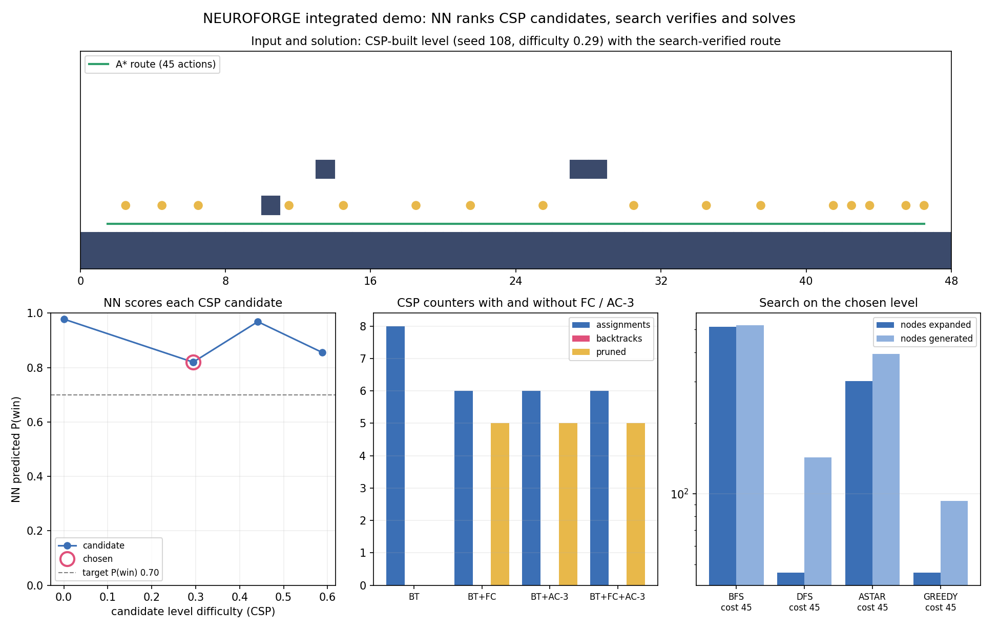
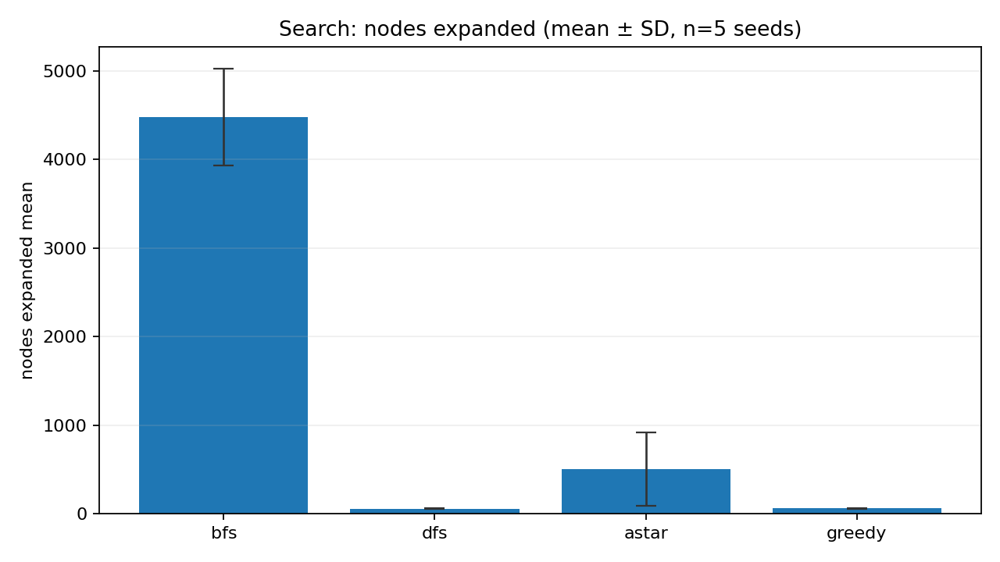
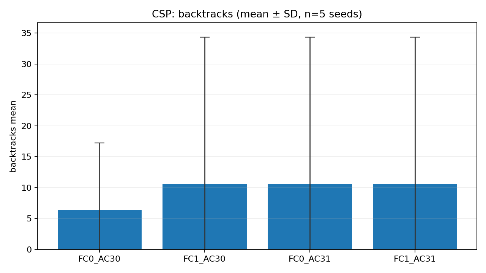
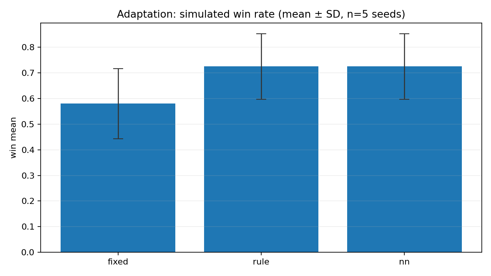

# NEUROFORGE: Adaptive Level Generation with Constraint Satisfaction, Search and Neural Player Modeling

*Technical report — 15 November 2026. All numbers below come from the files in `results/`, regenerated on this date with the commands shown. Team names, institutional details and individual contributions must be supplied by the students.*

## Abstract

We implemented NEUROFORGE, a tile-based 2D platformer that integrates (i) a finite-domain constraint satisfaction problem (CSP) for level construction, (ii) Breadth-First Search (BFS), Depth-First Search (DFS), A* and Greedy Best-First Search on one shared, time-aware physics transition system, and (iii) a neural network (NN) that predicts whether a given player will complete a given level. A controller builds several CSP-valid candidate levels, verifies each with A*, and ranks them using the predicted completion probability and a per-player challenge level. The game has a manual mode and a four-agent arena in which each search algorithm plays its own levels and replans when the world changes unexpectedly. We built a reproducible synthetic dataset of 6,500 attempts, held out entire player personas for evaluation, and ran three experiments with five seeds each. The integration works end to end, but the NN **does not outperform** a logistic-regression baseline on held-out synthetic data, and every adaptation result is simulated; validation with human players remains future work.

## 1. Problem statement and research questions

Fixed platformer levels do not respond to player variation, and unconstrained random generation can produce unreachable maps. We study a generation process in which a player model suggests an appropriate challenge, a CSP enforces hard design constraints, and graph search checks that the resulting level can actually be traversed. Our questions are: (RQ1) how do four search policies differ on the same movement graph, (RQ2) how do Forward Checking and AC-3 change the work done by the CSP solver, and (RQ3) does NN-guided level selection come closer to a target success probability than fixed or rule-based selection under a simplified simulator?

The architecture is inspired by experience-driven procedural content generation [1] and by constraint-based platformer construction in Tanagra [2]. We implement a compact original game and do not claim to reproduce those systems.

## 2. System and mechanics

Each tile map contains solid blocks (`#`), static spikes (`^`), coins (`o`) and empty space (`.`). Levels may also contain three kinds of dynamic object: moving platforms that carry the player, patrolling enemies, and timed gates. All of them follow one shared 8-tick cycle. A search state is `s = (x, y, v_y, phase)`: tile column, feet row, discrete vertical velocity and the current position in that cycle. Including the phase makes waiting a meaningful action, because a gate or patrol may only be passable at certain ticks.

Every action (left, right, wait, jump-left, jump-right, jump-in-place) advances one logical tick through the single function `game.physics.step`, which the Pygame game and all four search algorithms share. It handles gravity, landing, wall and ceiling collisions, falling, being carried by a platform, swept collision with spikes during a jump or fall, and head-on crossings with enemies. All legal edges cost one tick. Motion is deliberately tile-discrete; it is not a continuous physics engine.

The goal is to reach the right-hand goal column alive. Because planning uses the real movement rules, a plan can never rely on a jump the character cannot make. When a search runs out of its expansion budget it reports `expansion limit`; only an exhausted frontier is reported as `No solution`.

## 3. Search algorithms

BFS uses a FIFO queue and returns a minimum-action path. DFS uses a LIFO stack and is neither optimal nor predictable in effort. A* orders the frontier by `f = g + h` and discards stale queue entries when a cheaper path to a state is found; Greedy orders by `h` alone. The heuristic is the horizontal distance to the goal, `max(0, goal_x − x)`. On levels with moving platforms a carried player can advance two tiles per tick, so the distance is halved (rounded up) to stay admissible. All four use the same graph, goal test and unit costs. Each run records nodes expanded, nodes generated, maximum frontier size, path cost, wall-clock time and a trace of expanded states that the game can replay.

## 4. CSP level generation

A level is a row of fixed-width chunks. Each position is a CSP variable whose domain is a catalog of 38 handcrafted chunk templates: safe ground, gaps, spikes, raised platforms, walls, mixed hazards, and six time-dependent templates (moving platforms, patrols, timed gates). Binary constraints between neighbours require a safe start, forbid two identical neighbours, forbid two adjacent chunks of difficulty 4 or more, and limit consecutive gaps. A global constraint keeps the summed chunk difficulty within one point of a budget derived from the requested target, and harder targets must include at least one (target ≥ 0.52) or two (target ≥ 0.81) dynamic chunks.

The solver is Backtracking Search with minimum-remaining-values variable ordering and seeded value ordering. Forward Checking and AC-3 are separate switches: Forward Checking removes incompatible values from unassigned neighbours after each assignment, and AC-3 propagates arc consistency over the binary constraints, both before search and after each assignment. AC-3 does not handle the global budget; backtracking does. The solver counts assignments, backtracks, pruned values, constraint checks and arc revisions.

After the CSP returns an assignment, the chunks are compiled into a level and A* must find a route. If it cannot, another seeded CSP candidate is tried, up to a fixed attempt budget; exhaustion returns an explicit `No solution` message. This separates design validity (CSP) from physical reachability (search).

## 5. Neural completion predictor and data

The input has 12 features: five recent-play metrics (win rate, jump accuracy, deaths per attempt, progress, time) and seven level descriptors (length, gap tiles, longest gap, hazards, coins, raised-platform count, realized difficulty). The model is a NumPy multilayer perceptron, 12→32→16→1, with ReLU hidden layers and a sigmoid output, trained with backpropagation and Adam on binary cross-entropy for 105 epochs. A logistic-regression baseline uses the same standardized features.

The 6,500 labels come from a **synthetic simulator**, not from people. Each of 250 simulated personas has a hidden skill, noisy observations of past performance, and 26 attempts on levels drawn from a pool of 72 search-verified levels; a stochastic function of skill and level challenge decides each outcome. The hidden skill and the simulator's probability are never model inputs. Whole personas are assigned to train (175 personas, 4,550 rows), validation (37, 962) or test (38, 988), so no persona appears in two splits. `python -m data.make_data --seed 42` regenerates the file from a fixed seed. The same command downloads four real Super Mario Bros level maps from the VGLC corpus [3], pinned to one upstream commit and checked against stored SHA-256 hashes, and preprocesses them into `vglc_features.csv` (size, solid-tile fraction, enemy count, longest ground gap). That real geometry carries no outcome labels and is not used to train the network; it documents how our generated levels compare with published ones. Every column is described in `docs/DATA_DICTIONARY.md`.

| Model (held-out test, 988 rows) | Accuracy | ROC-AUC | Brier | Log loss |
|---|---:|---:|---:|---:|
| Neural network 12→32→16→1 | 0.691 | 0.740 | 0.216 | 0.681 |
| Logistic regression baseline | 0.743 | 0.798 | 0.179 | 0.534 |

The baseline is better on every metric. The NN's final training loss (0.42) is well below its test log loss (0.68), which indicates overfitting; the simulator's outcome function is also close to linear in skill and challenge, a setting that suits logistic regression.

During play the trained network stays frozen. Each player, human or agent, has a small online adapter (13 parameters) that corrects the network's output. It updates only after every 10 new attempts, uses 12% feature dropout, and never revisits old data. By default, after every third update 35% of its feature weights are reset to zero, a deliberate "memory glitch" that later batches must recover from. This is a teaching device; we do not claim it improves accuracy.

## 6. End-to-end integration

After each attempt the game records the result, time, jumps, safe landings and progress; the last eight attempts form the player profile. The controller keeps a challenge level per player that rises after wins and falls after losses. For the next level it asks the CSP for several candidates around that challenge, keeps only those A* can solve, and asks the NN for `P(win | profile, level)`. Each candidate is scored by its distance from the challenge level (weight 1.4), the distance of its predicted win probability from the 0.70 target (weight 0.22) and a penalty for repeating a recent layout; the lowest score is chosen. The challenge level therefore dominates the choice and the NN refines it. With the NN switched off, a rule-based estimate replaces the prediction.

`python run_demo.py` prints the player profile, the candidates, the chosen level, the CSP counters, all four search results and an impossible-case message, then saves the figure below and opens the game. The figure shows the chosen level with the verified route, the NN score of each CSP candidate, the CSP counters under each pruning setting, and the work each search algorithm did.

In the four-agent arena each algorithm controls its own player on its own levels. The world can change mid-attempt (a new spike or patrol, a shifted gate or platform timing, a bridge, coins). A change is accepted only if the agent is not killed outright and its own algorithm can still find a route; the agent then replans from its current state.

## 7. Experiments and measured results

Produced by `python -m eval.run_experiments --seeds 11 22 33 44 55`. Standard deviations are sample SDs over the five seeds.

### Experiment 1: Search comparison

Seven-chunk levels at target difficulty 0.6, one per seed. All four algorithms solved all five levels.

| Policy | Nodes expanded (mean ± SD) | Nodes generated (mean ± SD) | Path cost (mean ± SD) |
|---|---:|---:|---:|
| BFS | 4479.8 ± 545.6 | 4537.4 ± 546.6 | 53.6 ± 1.3 |
| DFS | 55.8 ± 2.0 | 187.2 ± 4.3 | 54.6 ± 1.8 |
| A* | 502.0 ± 413.9 | 1190.4 ± 490.8 | 53.6 ± 1.3 |
| Greedy | 58.8 ± 4.6 | 276.0 ± 5.1 | 53.6 ± 1.3 |

BFS and A* return the same optimal cost; A* expands about nine times fewer states. DFS expands the fewest states but its paths are one action longer on average. Greedy matched the optimal cost on these five levels, which is not guaranteed in general. A* effort varies widely between levels (SD 414), consistent with a heuristic that sees only horizontal distance and not timing or height. Wall-clock times are in `results/search_summary.csv`; they depend on the machine and on run order, so we do not compare them here.

### Experiment 2: CSP pruning

Ten-chunk problems at target 0.73. All four settings solved all five problems.

| Mode | Assignments (mean ± SD) | Backtracks (mean ± SD) | Pruned values (mean ± SD) | Constraint checks (mean ± SD) |
|---|---:|---:|---:|---:|
| Backtracking | 17.4 ± 11.4 | 6.4 ± 10.8 | 0 ± 0 | 23.2 ± 22.7 |
| Backtracking + FC | 20.6 ± 23.7 | 10.6 ± 23.7 | 11.6 ± 0.9 | 378.4 ± 63.5 |
| Backtracking + AC-3 | 20.6 ± 23.7 | 10.6 ± 23.7 | 11.6 ± 0.9 | 1341.6 ± 110.9 |
| Backtracking + FC + AC-3 | 20.6 ± 23.7 | 10.6 ± 23.7 | 11.6 ± 0.9 | 1444.2 ± 126.8 |

Propagation prunes about 12 values per problem but does not reduce assignments or backtracks here, and it costs many more constraint checks. The SDs are as large as the means: a single hard seed dominates each average, so five seeds cannot separate the modes. A likely reason for the weak effect is that the binary neighbour constraints are loose, while the global difficulty budget, which neither Forward Checking nor AC-3 propagates, causes most dead ends; we did not measure this directly.

### Experiment 3: Simulated adaptation

Eight simulated personas × five rounds per seed (40 attempts per method per seed). SDs are across the five seed-level means.

| Strategy | Simulated win rate | Mean level difficulty | Distance of prediction from 0.70 target | Absolute prediction error |
|---|---:|---:|---:|---:|
| Fixed difficulty | 0.580 ± 0.137 | 0.572 ± 0.003 | 0.206 ± 0.068 | 0.449 ± 0.018 |
| Rule-based adaptation | 0.725 ± 0.128 | 0.304 ± 0.003 | 0.156 ± 0.016 | 0.358 ± 0.090 |
| NN-based adaptation | 0.725 ± 0.128 | 0.304 ± 0.004 | 0.346 ± 0.022 | 0.457 ± 0.075 |

Both adaptive methods bring the simulated win rate close to the 0.70 target (0.725) where fixed difficulty gives 0.58. The NN and rule-based controllers reach the same win rate because the challenge level, not the predictor, dominates level choice (Section 6), so both pick nearly the same levels. The NN's own predictions are worse than the rule's: larger absolute error and further from the target. In this prototype the NN adds no measurable benefit over the rule.

### Supplementary: replanning under world surprises

`python -m eval.reactivity_study --seeds 11 22 33 44 55 --rounds 3` runs each arena agent for three attempts per seed with and without surprises (archived run; not regenerated for this report).

| Agent | Replans without surprises | Replans with surprises | Win rate with surprises |
|---|---:|---:|---:|
| BFS | 2.6 ± 1.5 | 8.4 ± 1.1 | 1.00 ± 0.00 |
| DFS | 6.2 ± 3.3 | 13.8 ± 3.3 | 0.93 ± 0.15 |
| A* | 1.6 ± 1.5 | 8.4 ± 2.4 | 1.00 ± 0.00 |
| Greedy | 9.6 ± 3.7 | 16.2 ± 1.1 | 0.93 ± 0.15 |

Each run saw six to eight accepted world changes, and every agent replanned after each one. With only three attempts per seed the win-rate differences are not significant.

## 8. Tests and rubric coverage

`python -m pytest tests -v` runs **44 tests, all passing** (15 November 2026). `tests/test_required_cases.py` holds the acceptance matrix: five normal cases (generated levels at five difficulties are CSP-solvable and physically traversable), three edge cases (start already at the goal, an obstacle that blocks walking but not jumping, no second jump in mid-air) and two impossible cases (a gap too wide to jump; a CSP with a contradictory start domain), both of which return `No solution`. Other tests check a flat level with a known answer for all four algorithms, BFS/A* optimality, all four FC/AC-3 combinations, seed reproducibility, NN training and saved inference, the online adapter's batch-of-ten updates and forgetting, timed gates, moving platforms and surprise replanning.

## 9. Limitations

- All outcome labels and adaptation results are simulated. Nothing here shows that the system adapts well to human players.
- The NN is weaker than logistic regression on this data and does not improve level selection over the rule-based estimate.
- Five seeds are too few to separate the CSP modes; the global budget constraint is not propagated.
- The distance heuristic ignores vertical layout and timing, so A* effort varies widely between levels.
- Movement is tile-discrete with an 8-tick world cycle. The chunk catalog is finite and handcrafted.
- The downloaded VGLC levels are only described, not played: they use a different tile vocabulary and physics from our engine, and they supply no player outcomes.

## 10. Conclusion

NEUROFORGE connects the three techniques in one loop: the CSP builds candidate levels, search proves they can be completed and plays them, and the player model helps choose the next one. The tests and seeded experiments make each step reproducible. The results are mixed: the search algorithms behave as theory predicts, constraint propagation prunes values without reducing backtracking on these problems, adaptive selection moves simulated win rates toward the target, and the neural network is outperformed by a simpler baseline. The next step is to collect real player data and test whether the adaptation helps people.

## References

[1] Yannakakis, G. N. & Togelius, J. (2011). Experience-Driven Procedural Content Generation. *IEEE Transactions on Affective Computing*, 2(3), 147–161.

[2] Smith, G., Whitehead, J., & Mateas, M. (2010). Tanagra: An Intelligent Level Design Assistant for 2D Platformers. *Proceedings of AIIDE*. https://doi.org/10.1609/aiide.v6i1.12379

[3] Summerville, A. et al. (2016). The VGLC: The Video Game Level Corpus. https://github.com/TheVGLC/TheVGLC

[4] Pygame Community Edition. https://github.com/pygame-community/pygame-ce
